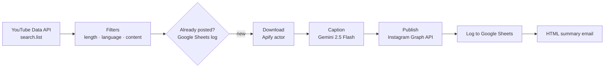

# Content Automation Pipeline

An automated Python pipeline that finds short gaming videos on YouTube, filters them, writes a caption with Gemini and publishes them to Instagram Reels. Each run ends with an HTML summary email. It runs on GitHub Actions, with no server to maintain.


## How it works



1. **Discover.** Searches YouTube for each configured query. It keeps paging through results, and retries with other sort orders and date ranges, until it has enough new videos. Paging is capped so one empty query can't use up the daily API quota.
2. **Filter.** Keeps only videos of 50 seconds or less. It rejects non-English videos using three signals together (language tag, script detection and keywords), and skips creator-on-camera or real-life challenge videos so the feed stays gameplay-only.
3. **De-duplicate.** Checks every candidate against a Google Sheet of already-posted URLs, which is the single source of truth between runs.
4. **Download.** Fetches the video through an Apify actor, so YouTube's blocking of datacenter IPs doesn't affect GitHub Actions runners.
5. **Caption.** Gemini writes a short caption specific to the video from its title, description and channel. The original creator is credited.
6. **Publish.** Creates an Instagram media container, uploads the bytes with a resumable upload, polls until processing finishes, then publishes.
7. **Report.** Sends an HTML email listing what was posted, what was filtered out and why, and any errors. Secrets are redacted from error text.

## Tech stack

| Area | Tools |
| --- | --- |
| Language | Python 3.12 |
| APIs | YouTube Data API v3, Instagram Graph API, Google Sheets API, Gemini API, Apify |
| Scheduling | GitHub Actions (daily cron + manual trigger) |
| Storage | Google Sheets (posting log) |
| Alerts | Gmail SMTP (HTML run summary) |

## Run it yourself

```bash
git clone https://github.com/varunpetekar/ultimate-content-automation.git
cd ultimate-content-automation
pip install -r requirements.txt
cp .env.example cred/.env   # then fill in your keys
python Main.py
```

Search queries and the number of videos per run are set in `main()` inside `Main.py`.

### Environment variables

| Variable | What it is |
| --- | --- |
| `YOUTUBE_DATA_V3_API` | YouTube Data API v3 key |
| `GEMINI_API_KEY` | Google Gemini API key |
| `INSTAGRAM_FACEBOOK_ACCESS_TOKEN` | Long-lived Instagram Graph API token |
| `INSTAGRAM_USERID` | Instagram Business account ID |
| `LURKAPI` | Apify API token for the video download actor |
| `SHEET_ID` | ID of the Google Sheet used as the posting log |
| `SHEET_TAB` | Sheet tab name (default `Sheet1`) |
| `GOOGLE_SERVICE_ACCOUNT_JSON` | Service-account JSON with access to that sheet |
| `GMAIL_SENDER` | Gmail address that sends the summary |
| `GMAIL_NOTIFIER` | Gmail app password for that address |
| `NOTIFY_EMAIL` | Where the summary email goes |

### On GitHub Actions

Put the full contents of your `.env` file in a repository secret named `CONFIG`. The workflow in `.github/workflows/auto-post.yml` writes it to `cred/.env` at run time. You can start a run from the **Actions** tab, or turn on the daily schedule by uncommenting the `schedule` block (08:00 IST).

## Status

The daily schedule is currently turned off, and runs are started manually from the Actions tab.

## Note on content

Every post credits the original creator in its caption and includes a removal-on-request notice. Use this only with content you have the right to repost.
